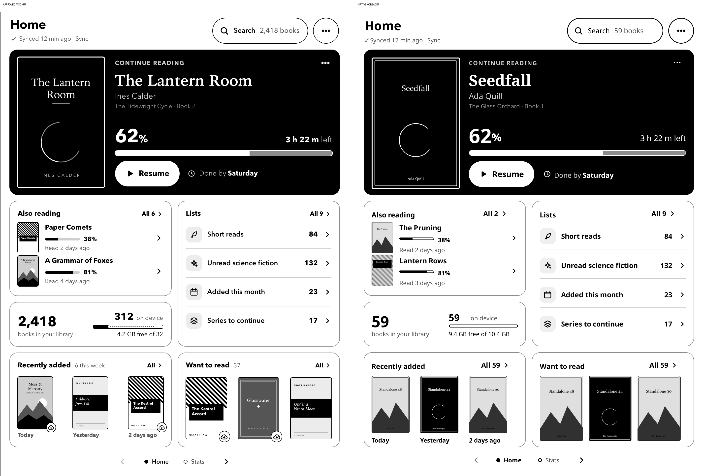
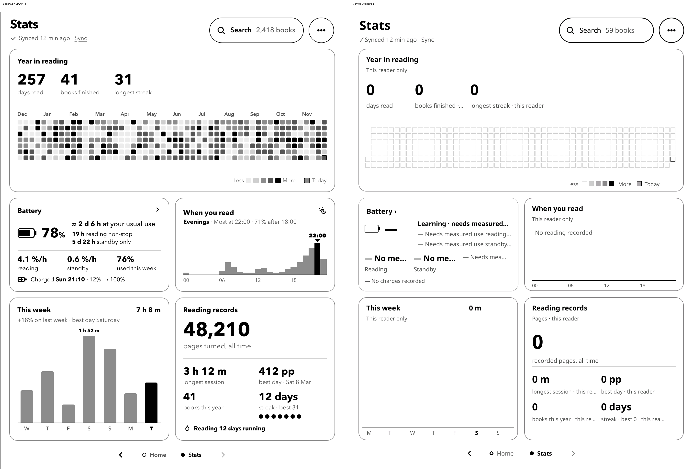
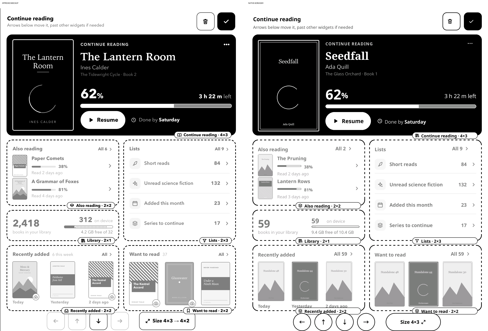
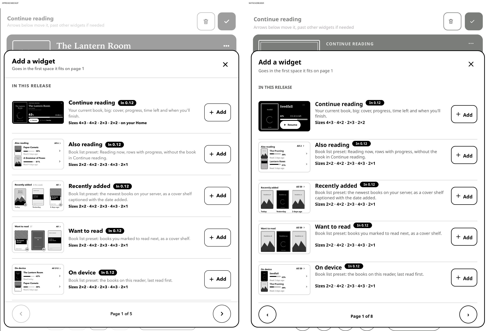
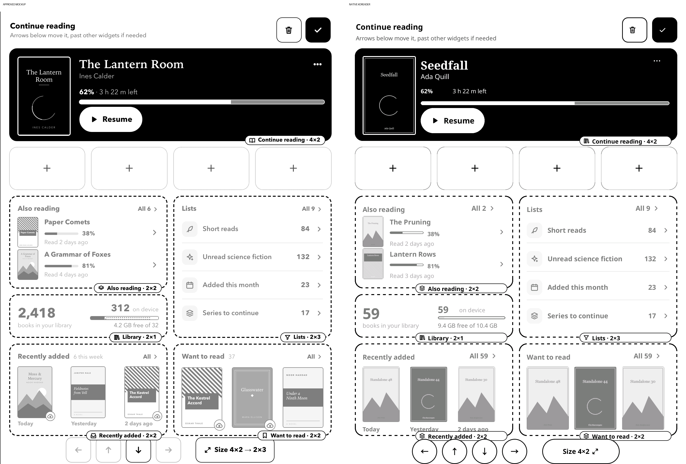
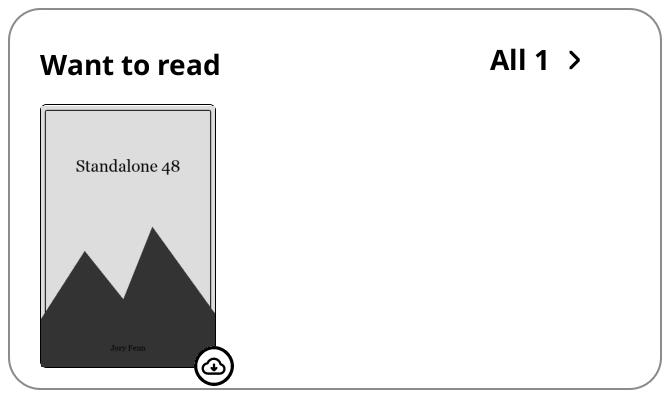

# V1 Home native verification

Approved mockup left, actual KOReader capture right. No image is resampled.
M8C emulator: 1404×1872, 300 dpi, KOReader v2026.07.1, opt-in fake ServerAdapter.
The fixture contains 59 synthetic books, raster covers, series, three saved reading
positions, finished-book metadata, recent dates and saved lists. No physical device
or external BookOrbit request is used. Setup requires Pillow for cover generation.

Fixture titles, cover artwork and counts differ; all 59 fixture books are on device, so no remote-download badges are expected.

V1 owns the header, grid and page indicator. Stats and Battery widget internals, their typography and session data come from the separately integrated X3/X2 work; this pair explicitly records the remaining styling differences.

Cached native previews; selected hero and dimmed/dashed neighbours. Uses the fixture library rather than the mockup's invented books.

Five illustrated choices, release badges, descriptions, size spans and Add actions; no projection reads. Page count follows the installed widget registry.

The same native size callback is exercised; free cells and neighbours stay in place.

Native cover specimen without a local file; the default fixture is fully on device.

## Validation

- Native `home.py`: default spans, ready views/covers, zero-query editor/picker,
  real move and next-fitting-size callbacks, saved layout persistence.
- Lua flows: 319 passed, 0 failed.
- Lua logic: 268 passed, 0 failed, plus 13 focused presentation assertions.
- KOReader source-symbol compatibility passed at pinned `9192014` (the optional
  koreader-base FFI static check was skipped); native FFI rendering ran on Android.
- Feature-matrix checks: 4 passed.
- External fixture APK assembled and `lintDebug` passed with strict Gradle
  dependency verification enabled.

The gallery is generated by `tools/e2e/android/home_gallery.py`. Native captures and
its JSON receipt come from `tools/e2e/android/home.py`; the capture tool rejects physical targets
through the existing Emulator guard. The capture tool resets its disposable layout
through the real layout save API, and restores defaults after persistence checks.

## Remaining differences

Noto Serif/Sans substitute for the proprietary mockup faces; native font hinting and
SVG rasterization differ. Book names, artwork, totals, available-cover state and
picker page count follow the synthetic fixture/installed registry. Stats/Battery
widget rendering and production data come from the integrated X3/X2 slices. Their
remaining styling differences include smaller text, truncated long metric labels, and empty local-session graphs in this fixture. These internals are outside V1; V1 changes page 2's host chrome and
placement only. This evidence does
not claim device acceptance or a release.
