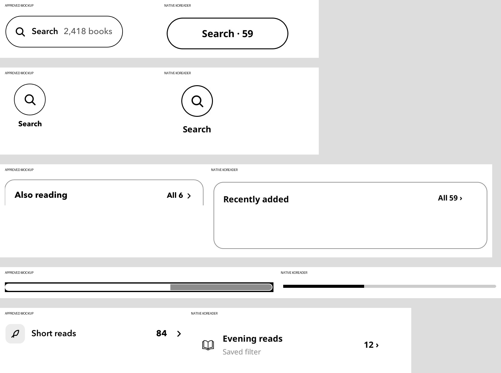
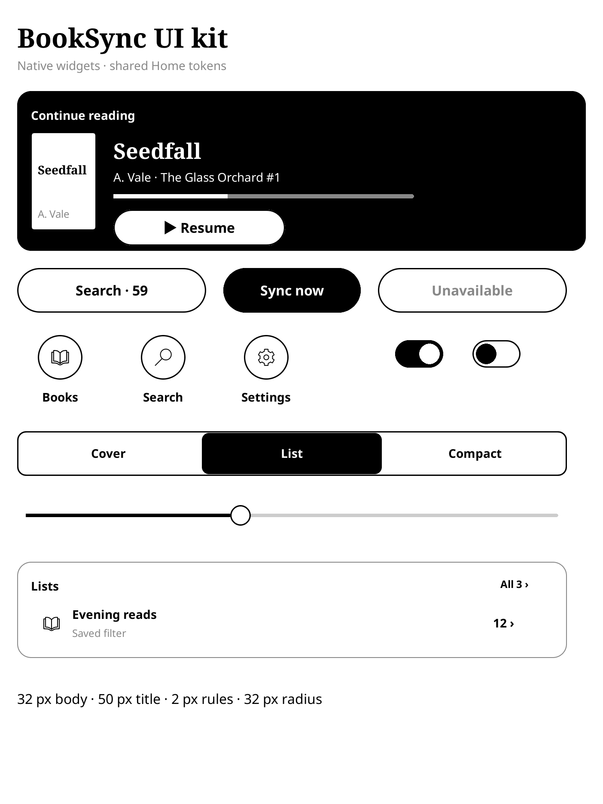

# V1 kit native evidence

M8C emulator, 1404×1872 at 300 dpi, actual KOReader v2026.07.1 widgets.
The disposable ServerAdapter fixture is the only server; no external BookOrbit calls.
The fresh AVD needed Bluetooth disabled after an Android system startup crash.

All twelve component renders and callback/edge-value assertions passed with
`python3 tools/e2e/android/ui_kit.py --serial emulator-5642 --out <external output>`.
The renderer writes the dimensions to [render-tests.json](render-tests.json).
The KOReader symbol compatibility check also passed at the repository's pin.

Differences: Noto Serif/Sans replace the prototype's proprietary Iowan/Avenir;
fixture labels/counts and placeholder covers are synthetic. Native SVG rasterization
and font hinting differ from browser output. The slider reports taps, without animated
dragging. This PR does not rebuild Home; the next V1 PR consumes these primitives.
