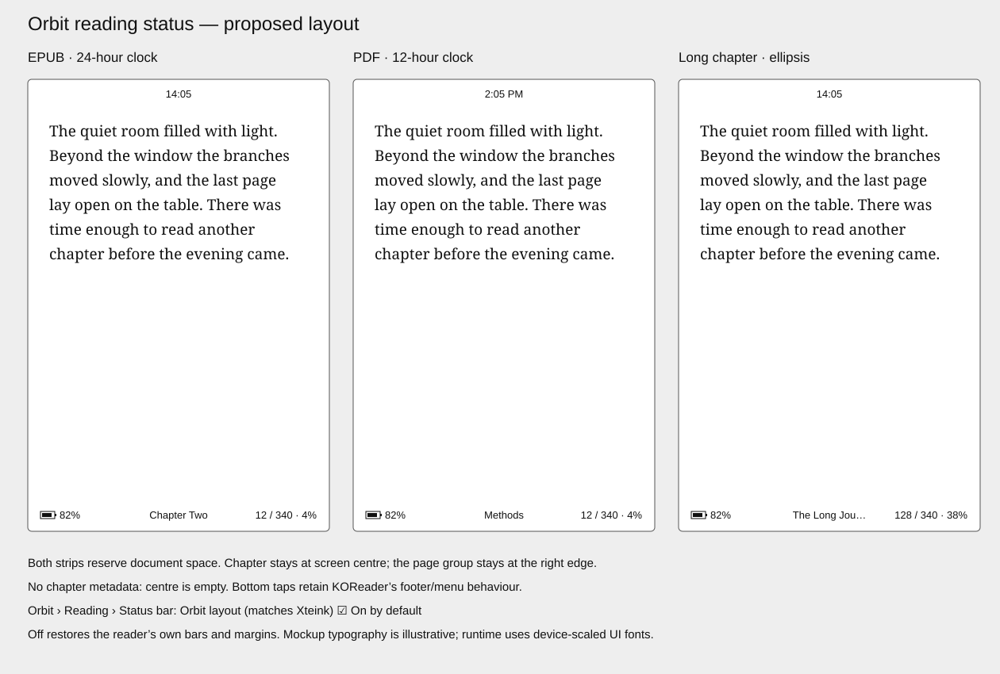

# KOReader reading status matches Xteink (W17)

Status: approved in chat, 2026-11-24 19:47 PST ("Yes do it."), including the
Xteink spaced page format; implemented by W17.
Platform: Android. Xteink already has configurable status slots; the shared format
fixture and host test will keep the BookSync preset consistent on both platforms.

## Native feasibility, checked against pinned source

KOReader v2026.07.1, commit `9192014d8bd82a91dc1012473be0f238dedfdb54`:

- `frontend/apps/reader/modules/readerfooter.lua:660`: item order is a list of unique
  modes. `:414` provides one dynamic filler, sized from the remaining line width.
- `readerfooter.lua:804`: left/right/centre alignment wraps the entire horizontal
  group. `:2129` concatenates generated items into a single string; `:1946` offers
  bar, bullet, middle dot and no separator. There are no independent left, centre
  and right item anchors. A filler can split two groups, but cannot keep a chapter
  at the physical centre between unequal side groups.
- `frontend/apps/reader/modules/readercoptlistener.lua:366`: the alternate top
  status bar belongs to CRE documents. It cannot supply a top clock for PDF/CBZ.
- `frontend/apps/reader/modules/readertypeset.lua:540`: CRE page margins add the
  footer height unless reclaimed. `frontend/apps/reader/modules/readerview.lua:751`
  reserves footer height in paged documents; `:1060` recalculates on visibility
  changes. `readerview.lua:344-346,359-363,449-456` identifies the rendered
  page bounds from `state.offset.y` and `visible_area.h`; only screen surround
  outside those bounds is safe to use as PDF/CBZ margin.

Native settings do not meet the complete request. Use a custom BookSync renderer
integrated into the reader view, retaining native footer gesture handling.

CrossInk v2.0.0+bookorbit.1-rc3, commit `87e2e1984481e8a3d996f12b34b50a383f9013b8`:

- `src/components/themes/BaseTheme.cpp:861` draws top/bottom status lanes and uses
  theme font metrics and display insets; `:94` places the battery icon before its
  percentage in reader mode; `:935` formats clock, battery, pages and percentages.
- `src/components/UITheme.cpp:334` selects SMALL_FONT_ID by default, or UI_10/UI_12
  for the two larger preferences. Android will use KOReader's small UI face with
  device scaling rather than copying unscaled panel pixels.
- `src/util/ReaderStatusBarConfig.h:46` includes the middle dot among supported
  separators. The upstream page item is `N/M` (`BaseTheme.cpp:958`), not the
  example's spaced slash. BookSync's shared preset will use `12 / 340 · 4%`, as
  requested, on both platforms; this is a small BookSync formatting change on Xteink.

These references are relative to each pinned upstream repository, not overlay-
modified checkout lines. Implementation must add every newly used KOReader hook
or symbol to `android/koreader/test/koreader_compat.lua`.

## Appearance and behaviour proposed for approval

The top strip contains only a centred clock, using KOReader's 12/24-hour preference.
The bottom strip contains an outlined battery and percentage at the left, chapter
at the physical screen centre, and `N / M · P%` at the right. All are monochrome,
with no divider line or progress bar. The SVG shows EPUB, PDF and a long chapter.
No chapter metadata means an empty centre, including CBZ without an outline.

Measure both sides first. The centre's available width is twice the distance from
screen centre to the nearer side group's inner edge, minus a small gap. Truncate
the chapter on Unicode boundaries with a single ellipsis using rendered widths.
On narrow displays suppress the chapter first and shorten the page text while
keeping the full battery percentage and charging mark together. If the entire
battery group cannot fit, omit it whole. Do not overlap the page group. Percent uses document reading
progress, clamped to 0–100 and rounded to the nearest whole percent; page numbers
use KOReader's document pagination. Missing/unknown totals show no progress group.

## W31 correction (maintainer brief approved)

The preview.1 regression is corrected: Small/Medium/Large select fixed 12/18/22
point faces. Small uses regular weight on both strips; Medium and Large remain
bold. Each strip measures its selected text line and adds one scaled pixel of
padding per edge. Neither native footer height nor page margins enlarge the text
or battery. Horizontal anchors follow scaled book margins or rendered PDF bounds;
the battery group retains its four scaled pixel inset and gaps.

For EPUB page mode only, an instance wrapper on the document margin setter uses
`max(user margin, strip height)`. It never changes unscaled margins, configurable
values, sidecars or global settings. Disabling removes the wrapper and reapplies
the user's margins through `ReaderTypeset:onSetPageMargins`, preserving the reading
anchor without closing/reopening the book. Scroll and PDF strips draw only where
a complete fixed-size line fits outside the document. A native CRE header still
suppresses the BookSync clock.

The native footer's effective height is zero while BookSync strips are active.
Their temporary `reclaim_height=true` is restored on disable. Separately, once per
reader instance, a height wrapper releases the native reservation whenever its
mode is off, including when BookSync strips are off. Visible native footers keep
the user's chosen height. This also repairs an already loaded 57-pixel hidden
reservation without guessing whether the saved value was deliberate: **no saved
footer height or reclaim preference is reset**. A session toggle removes the
BookSync paint hooks and timer; the hidden-footer height policy lasts until that
reader instance is discarded.

At pinned KOReader commit `9192014d8bd82a91dc1012473be0f238dedfdb54`,
`frontend/apps/reader/modules/readerfooter.lua:578` scales `container_height`,
`:994-1002` returns measured footer content height, and
`frontend/apps/reader/modules/readertypeset.lua:541-554` adds that height even in
footer mode 0 when `reclaim_height=false`. Thus the log's 57 px is measured native
layout, not evidence that BookSync saved a corrupt height. BookSync's old Small
cap of 48 pt then grew into that reservation. The log cannot recover a user's
original numeric footer height; resetting one would risk overwriting their choice.

Native footer taps while strips are active toggle only the private bottom-lane
visibility. Native settings and refresh timers retain their own controller.

The shared sleep/reading battery program retains a black outline and terminal,
white inner gap, and black proportional fill at 0–100%. A wider gap prevents the
outline merging into the fill at full capacity; the reading glyph's scale uses
the capital H ink height of the selected face, rounded down to whole pixels,
rather than the line box. This applies at every size and display scale; the
charging mark shares that height. At pinned KOReader commit
`9192014d8bd82a91dc1012473be0f238dedfdb54`,
`frontend/ui/widget/textwidget.lua:97-114` selects the adjusted weight and measures
the font line box; `frontend/ui/rendertext.lua:158-190` exposes capital ink above
the baseline as `sizeUtf8Text(...).y_top`. Both canvases retain the same black/white polarity.

### One-time repair

The old controller has no per-book change journal. On companion service startup,
`StatusMarginRepair` runs on the existing background bulk executor and checkpoints
before folder visits, file comparisons and writes. It walks external storage
without following symlinks or entering Android app-private trees, covering book
sidecars plus KOReader's central `docsettings` and `hashdocsettings` sidecars.
It compares `metadata.*.lua` against `metadata.*.lua.old`. Following the W31 brief,
only `copt_t_page_margin`, `copt_b_page_margin`,
`copt_sync_t_b_page_margins`, and `reader_footer_mode` may be restored. For
`koreader/settings.reader.lua`, only `reader_footer_mode` may be restored.
The old overlay explicitly wrote that global key; no other global footer table
field was written, so the repair never replaces the `footer` table.

A lexer skips quoted strings, long strings and comments without executing Lua.
Only top-level scalar values on that allowlist are patched; every unrelated byte,
including horizontal margins, fonts and reading position, stays intact. Missing
keys in the backup remove those keys from the repaired file. Missing backups or
unsupported values are left untouched: there is no inferred default. The backup
cannot establish whether a later user change caused an allowlisted difference;
this is the conservative key-limited fallback requested by the maintainer.

While a book is loaded or its current state is unknown, capture differing `.old`
backups as `.booksync-w31.old` without changing native settings. This preserves
the recovery source if KOReader rotates `.old` on close. Actual repairs wait for
a live closed-book report, rather than trusting a persisted state from a prior
session. Before replacement, the current bytes are saved as `.booksync-before-w31` and
rechecked for concurrent native saves. `.old` is never touched. Per-file
`.booksync-w31.done` markers prevent an interrupted scan from restoring a user's
later choices again, and a completion marker records the last completed walk. A new closed-book report
following an open book scans again, so newly discovered history books are included.
Book opening never waits for a repair or wraps `ReaderUI.showReader`. Logs identify
repairs by a path hash, without book titles or paths. Interrupted or failed walks
retry on a later service startup or closed-book report. Opening a book during
the walk defers the remaining work. Close an already-open book to allow the repair;
reopen after repair to use the recovered margins. The companion also sends a bounded `native_footer_repair` mailbox event with the
original and recovered global mode. The plugin changes only a matching scalar in
`G_reader_settings` through its native settings API, so a subsequent native flush
cannot undo the disk repair. It does not change the loaded footer or reflow an open
book; the recovered global mode takes effect on the next book open. A persisted
repair token makes mailbox replay harmless to later user choices. Recovery source
snapshots survive `.old` rotation, including across companion restarts.

At pinned KOReader commit `9192014d8bd82a91dc1012473be0f238dedfdb54`,
`frontend/apps/reader/modules/readertypeset.lua:541-552` adds native footer height
to CRE margins unless reclaimed; `frontend/document/credocument.lua:1346-1351`
applies engine margins. The instance wrapper changes only effective engine margins;
saved unscaled margins are untouched.
`frontend/apps/reader/modules/readerfooter.lua:2485-2510` changes native footer
mode and persists it; the overlay consumes that event without invoking this path.
`frontend/ui/widget/textwidget.lua:30-35` defines bold/black text and widget
padding; all measuring and drawing use the same explicit parameters.

X4 and X4 Pro use the shared spaced page format; centered/custom status groups keep
their configured separator. X3's build flag is zero: preprocessing retains the exact
native page/percent formatting and excludes the new formatter header. The existing
99.5% firmware flash gate remains mandatory.

## Implementation and verification after approval

- Put pure formatting/layout/truncation logic in the plugin's logic directory and
  UI/lifecycle integration in its ko directory. No network, scans or background work.
- Add `shared/fixtures/status/format.json` and its registry entry; have Lua tests
  and an Xteink host test read it. Apply any Xteink preset format adjustment through
  BookSync's overlay, with no upstream contribution.
- Cover Unicode, empty chapter, narrow widths, unequal sides, percent boundaries,
  12/24-hour midnight/noon and unknown totals with Lua unit tests.
- Flow tests cover native state snapshot/restore, repeated toggles, book close,
  clock cleanup, zero reservation in every mode, text fitting, byte-identical native
  settings and private footer gestures. Add partial dirty-region checks for minute/battery updates.
- Run plugin logic/flow suites and pinned KOReader compatibility checks. Run the
  affected Xteink host suite. CI is the merge gate; no device tools or release tags.
- One PR holds this design and implementation. Keep this outcome in ROADMAP until
  shipped; then move it into FEATURES in the same change. Real-device visual and
  gesture verification is for the user before a release.

W34 additionally checks KOReader `9192014d8bd82a91dc1012473be0f238dedfdb54`:
`frontend/luasettings.lua:270-274` unconditionally dumps the loaded settings on flush;
`frontend/ui/uimanager.lua:222-225` flushes before CloseWidget. Updating native global
memory as well as the file is required to retain the recovered footer mode.

## Preview.1 log findings (device local time, 2026-11-25)

All Books opening notices at 16:40:22.917 and 16:40:38.377 precede first paints at
16:40:29.656 and 16:40:45.093: **6.739 s and 6.716 s**. Cache-hit lines occur at
16:40:29.404 and 16:40:44.923 (6.487 s and 6.546 s after the notices), followed by
paint in 252 ms and 170 ms. Both pages came from cache; validation is scheduled in
the background. The delay is before the cache-hit log (subprocess scheduling and
cache assembly are not separately timed), so this log cannot attribute it to a
server fetch or identify a safe targeted performance fix. First-open covers
finished at 16:40:34.165, another 4.509 s after first paint; the second open had
all 12 covers on disk.

The apparent home/back flash includes an opening-file notice at 16:44:29.287,
reader open at 16:44:29.394 and ready at 16:44:29.826. Another reopen occurs at
16:47:58.995. Neither is preceded by a BookSync close/reopen/restart command in
the log. Status setting callbacks only change instance hooks; the corrected
layout uses in-place margin updates, never a reader close or reload. The log is
insufficient to assign the reopen to a specific native setting action.

A single Refresh tap now checks for a running Full refresh before network checks
or normal refresh notices. It expands that run's existing progress badge with the
latest status, leaving the run and catalog view intact. Long press keeps its
existing Full refresh behavior.
